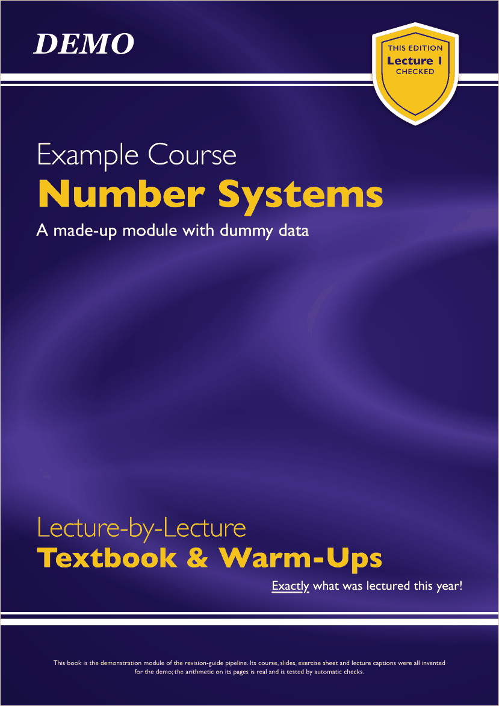
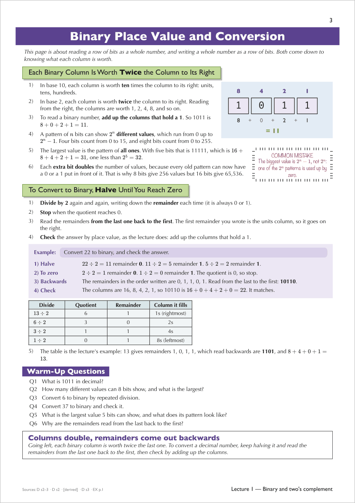
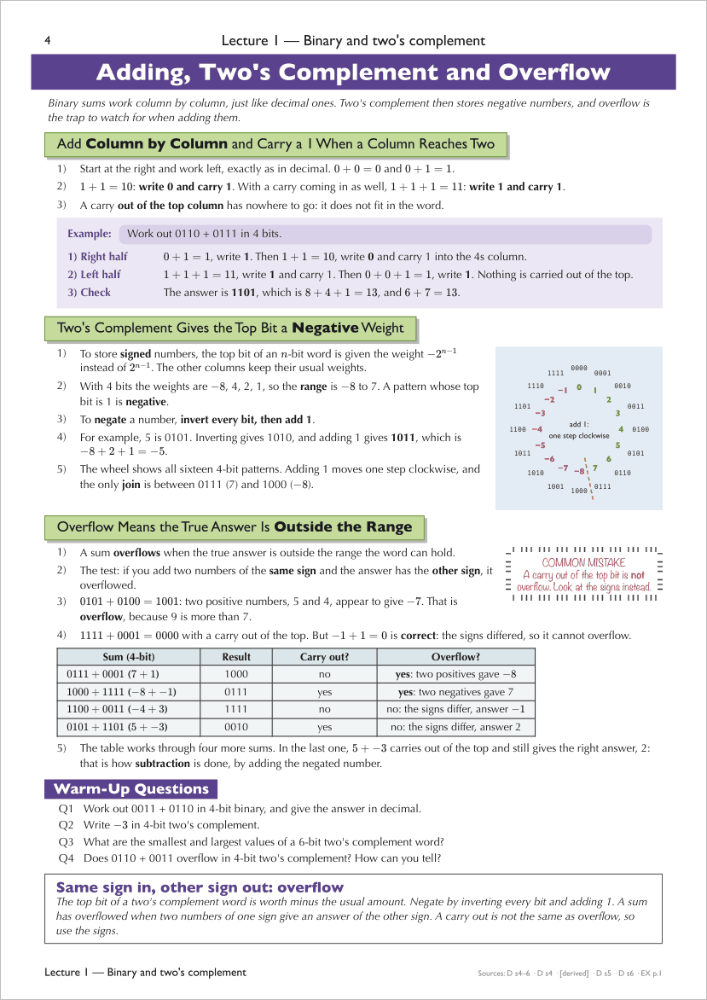
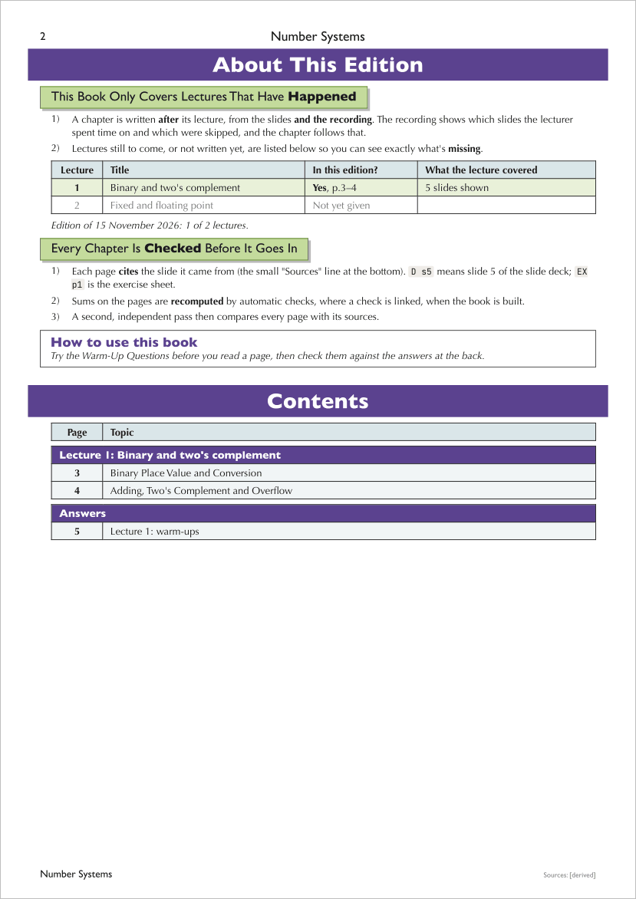

# revision-guides

A pipeline that turns a lecture course's own materials (slides, lecture recordings, exercise sheets, past papers) into a printed-style revision textbook, one chapter per lecture, in the look of a CGP revision guide. Every page cites the slide it came from, every worked sum is recomputed by a test, and a second, independent pass compares each page with its sources before the page is allowed into the book.

**This repository holds the pipeline only.** The modules it was built for are not here: course materials are copyrighted, and the chapters, question banks, timelines and notes derived from them stay on the author's machine.

## What it produces

The pages below were built by the pipeline from a made-up two-lecture course, "Number Systems", whose slides, exercise sheet and lecture captions were dummy data (not included). The arithmetic on them is real and was recomputed by tests at build time.

| Front cover | A chapter page | Another chapter page | About this edition |
|---|---|---|---|
|  |  |  |  |

What those pages show of the rules:

- **The lecture decides the content.** One slide of the deck (octal and hexadecimal) was never shown in the recording, so the chapter has no section on it. The second lecture had not happened, so it has no chapter, and the edition page says so.
- **Every topic is one whole page, full to the foot.** The build prints a FIT report and fails a topic page with more than 70px free.
- **Citations resolve.** The small "Sources" line at the foot of a page lists the slides it was written from (`D s5` is slide 5 of the deck). A citation that points nowhere fails the build; `tools/cite <m> "D s5" --text` prints what one points at.
- **Derived maths has a test.** Every sum, conversion and range on those pages is recomputed by a check; a wrong digit fails the build.
- **Verification is recorded.** A chapter only enters the book when an independent pass has compared every page, at its current version, with its cited sources.
- **The cover is generated.** Its badge names the lectures the book holds, worked out by the build from the chapters that passed.

## Setup

```sh
python3 -m venv .venv
.venv/bin/pip install --only-binary=:all: "pymupdf<1.27" pyyaml sympy numpy scipy matplotlib pillow pandas
npm install                    # Google Chrome must be installed: Playwright prints the PDFs with it
tools/new-module <id> "<Title>" <course-page-url/>     # then fill in sources.yaml and lectures.yaml
tools/gui                      # http://127.0.0.1:4747: the bookshelf, each book's lectures, page review
```

Building, linting, coverage and the checks run locally. The steps that use Claude are headless Claude Code sessions, so they need a Claude subscription and cost usage: `tools/verify`, `tools/omissions`, `tools/place`, `tools/describe` and `tools/batch`, which writes chapters.

## How a book is made

1. **Sources.** `modules/<m>/sources.yaml` lists every source with the id used in citations. `tools/ingest <m>` fetches or imports the files into `sources/<m>/` (gitignored) and splits them into pages.
2. **Timeline.** `modules/<m>/lectures.yaml` has one row per lecture: date, slide range, which recording belongs to it. `tools/lectures <m>` says where each lecture stands and what to do next.
3. **Coverage.** `tools/lectures <m> coverage <n>` compares the recording with the slides (video frames when there is a video, captions otherwise) and records which slides the lecture really covered.
4. **Evidence.** Every other unit of the sources (a notes page, a sheet question, a past-paper part) is linked to its lecture; `tools/lectures <m> audit` must be clean before a chapter is written.
5. **Writing.** `tools/batch --only <m>:<n>` writes a lecture's chapter in a series of fresh headless sessions: describe the slide images once, draft within a page budget, read the whole chapter, verify, review for gaps, fix. Each step sees only what it needs.
6. **Gates.** `tools/build <m> l<nn>` renders the chapter and runs the lint; `tools/lectures <m> gate <n>` checks that every covered slide is cited; `tools/verify` checks every page against its cited sources and writes the ledger.
7. **Book.** `tools/build <m> book` merges every finished chapter in lecture order behind a cover, an edition page and a contents page, then reads the PDF back to check page numbers and contents. `tools/release <m> book` copies it to a folder (gated on all of the above).

`tools/update <m>` runs steps 1–4, 6 and 7 in one go.

## Layout

| Path | What |
|---|---|
| `tools/` | The pipeline. Each command is a small wrapper (`tools/build`) around a script (`tools/build.mjs`, `tools/lectures.py`) |
| `tools/overnight/` | The batch writer and the prompts for each of its steps |
| `theme/` | CSS and the HTML template. `cgp.css` is the book theme, front cover included |
| `docs/FORMAT.md` | The page source format: front matter, directives, citations, lint rules |
| `docs/STYLE_GUIDE.md`, `docs/WRITING_A_CHAPTER.md` | How content is written and what a chapter must contain |
| `docs/img/` | The screenshots above |
| `modules/<m>/module.yaml` | Title, sections (chapters), the book, KaTeX macros |
| `modules/<m>/sources.yaml`, `lectures.yaml` | Source manifest and lecture timeline |
| `modules/<m>/content/<section>/*.md` | One file per topic; `content/book/` holds the cover, edition and contents pages |
| `modules/<m>/checks/*.py`, `figures/*.py`, `questions/*.yaml` | Tests for derived maths, figure scripts (drawn from the same numbers the checks use), past-paper questions |
| `modules/<m>/verify/` | The verifier's ledger and a snapshot of each page as last verified |
| `sources/`, `out/` | Course files and build output. Gitignored |

## What is not in this repository, and how that is enforced

Not published: the real modules, the hand-built pilot, archived chapters, design decisions, the project log, source notes, and the scripts that fetch files from one university's own sites. The code and docs refer to "decision 0007" and the like; those are the private design notes.

The author's working repository has all of it, in a history that is never pushed. `tools/publish` builds a separate `public` branch from an explicit list of paths, scans that tree for personal or course-derived text (home-directory paths, e-mail addresses, cloud-drive links, plus a local list of names), and only then pushes that branch. A `pre-push` hook (`tools/hooks/pre-push`) refuses every other push.

## Notes

- Built and used on macOS: the theme uses system fonts (Gill Sans, Optima, Noteworthy) and the batch writer uses `caffeinate`.
- The past-paper and examiners'-report handling in `tools/ingest.py` and `tools/lib/examiners.py` follows one department's public website layout; a module without a `tripos:` block does not use it.
- "CGP" is a trade mark of Coordination Group Publications Ltd. This project is not connected with them; it imitates the page layout of their revision guides for personal study.
